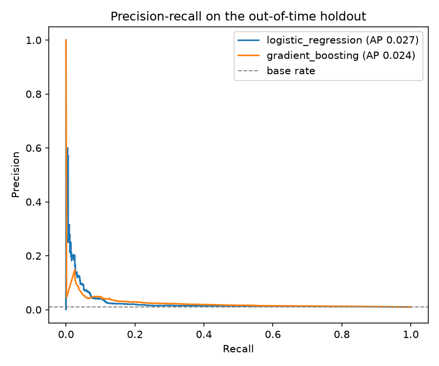
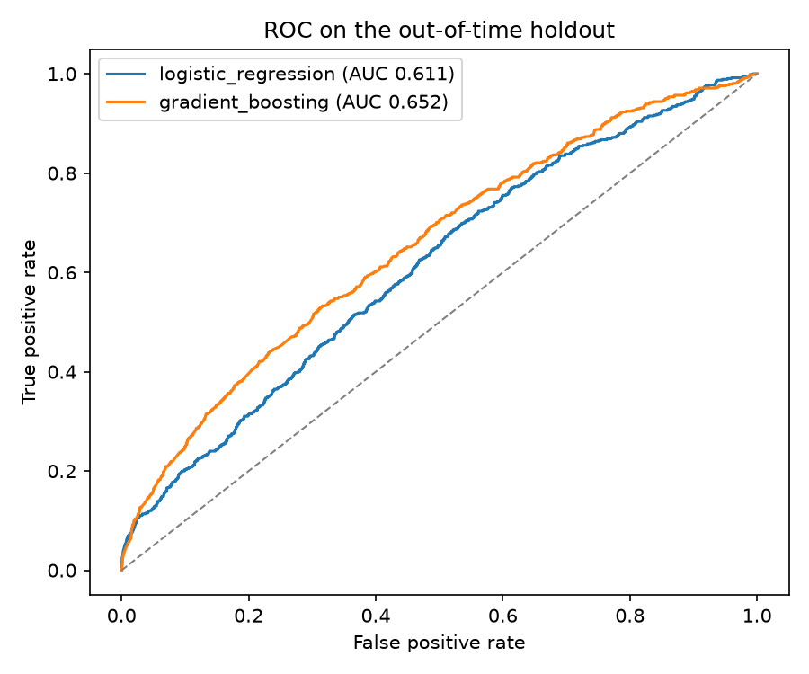
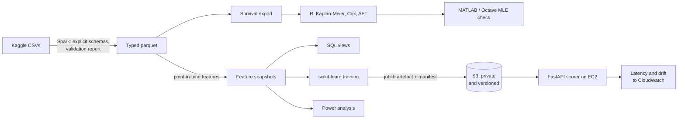
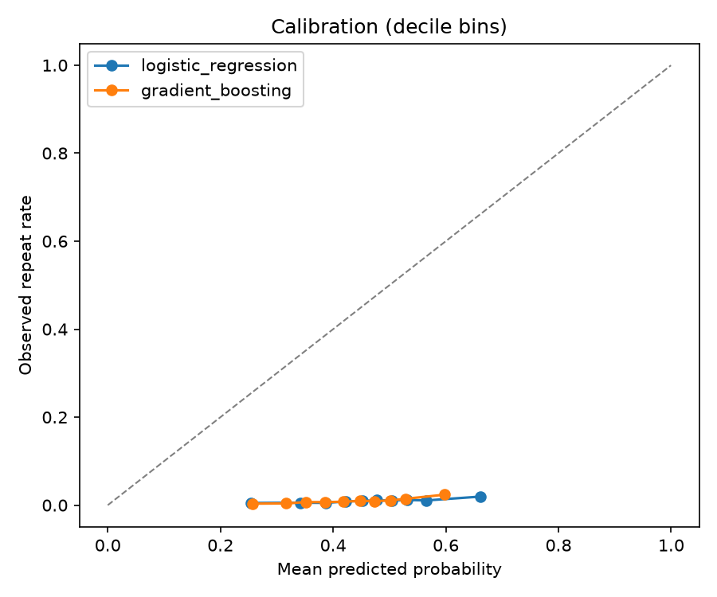
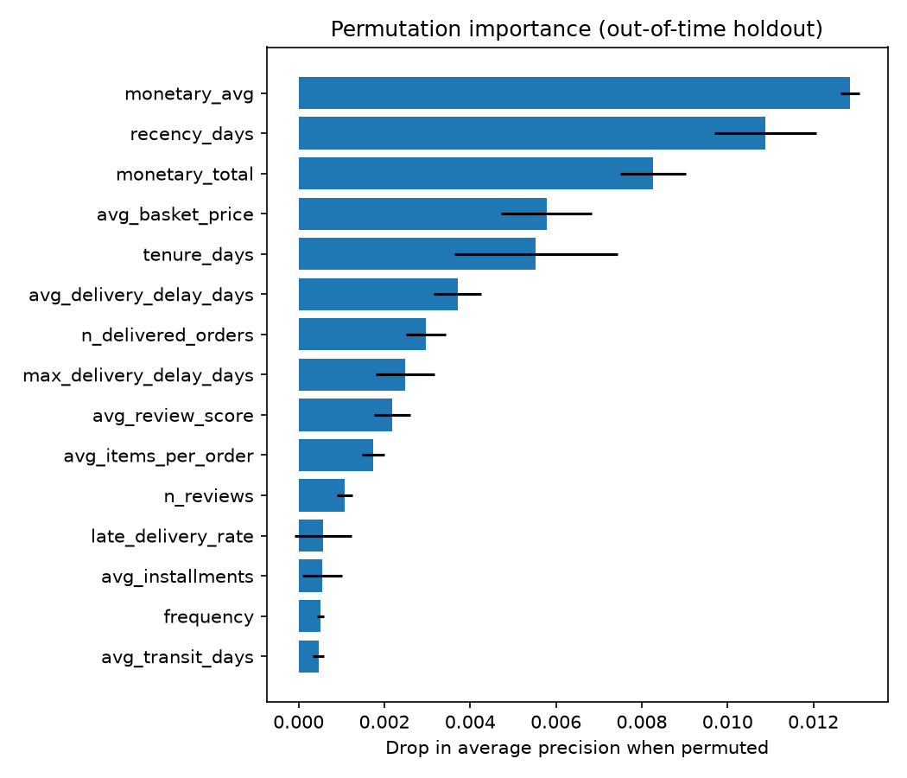

# Customer retention on real e-commerce data

[](https://github.com/ariyan-tipu/olist-customer-retention/actions/workflows/ci.yml)
[](LICENSE)

Churn modelling, survival analysis and experiment design on the Olist
Brazilian e-commerce dataset: 99,441 real orders across nine relational
tables, with all the mess that implies. The pipeline is PySpark, the
models are scikit-learn and Keras, the statistics engine is R's
`survival` package, and MATLAB re-derives the key fit from the raw
likelihood as a validation step. The trained model is served by a FastAPI
application that reads it from S3, reports its own latency and measures
whether the customers it is being asked about still look like the ones it
was fitted on.

The data does not cooperate, and the write-ups say so: a repeat-purchase
base rate near one percent, 98% censoring, and an experiment that turns
out to be expensive to run properly. Those are the real numbers, reported
as what the data supports rather than worked around. The most useful
finding is a negative one, and it is in the table below.

Everything needed to reproduce the results runs on a laptop for nothing.
The scorer is deployed on an AWS Free plan account, which cannot be
charged: **<http://35.178.111.113/readyz>**, with
[docs/deployment-aws.md](docs/deployment-aws.md) covering what that means
and how to take it down. Paths are configuration rather than constants,
so the same jobs run against a Databricks volume or an S3 prefix without
a code change. That claim has been checked rather than asserted: the
pipeline was executed on a Databricks serverless cluster and every
figure matched the laptop, recorded in
[results/databricks_run.json](results/databricks_run.json).

## Results at a glance

Every number below is produced by code in this repository; rerun the
quickstart and they regenerate.

**Repeat purchase prediction** (label: any further purchase within 180
days of the cutoff; trained at 2018-01-01, evaluated out of time at
2018-04-01):

| Model                    | CV avg precision | Holdout ROC-AUC | Holdout PR-AUC | Lift at top decile |
| ------------------------ | ---------------- | --------------- | -------------- | ------------------ |
| Logistic regression      | 0.0318 ± 0.0117  | 0.611           | 0.0265         | 2.00x              |
| Gradient boosting        | 0.0278 ± 0.0121  | 0.652           | 0.0244         | 2.45x              |
| Keras MLP (TensorFlow)   | 0.0364 ± 0.0091  | 0.577           | 0.0255         | 2.10x              |

The holdout base rate is 0.975% (64,089 customers), so a PR-AUC of
0.026 is nearly triple the no-skill line, and targeting the top decile
captures 20 to 24% of all repeaters at twice the background rate. On
customers the training snapshot had never seen, lift drops to 1.61x and
that is reported too.

### The neural candidate did not earn its place, and that is the result

The dense network was added to test a common assumption rather than to
decorate the stack, and the measurement came back against it.

It led cross-validated average precision at 0.0364. The gap to the
logistic regression is 0.0046, which is half of the network's own
fold-to-fold deviation of 0.0091, and every one of the three candidates
sits inside that deviation. Cross-validation, on this data, at this base
rate, cannot tell the three apart. An argmax over numbers that close is
reading noise.

The out-of-time snapshot then ranked the network last on ROC-AUC, at
0.577 against 0.652 for gradient boosting. It was also measured for what
it costs to run: 402 MB of resident memory against 90 MB, and 33 ms
per scoring request against roughly 1 ms, because TensorFlow has to be
in the serving image at all.

So the selection rule carries a tie-break, in
[`models/train.py`](src/olist_retention/models/train.py): when candidates
sit within one standard deviation of the leader, the cheapest to serve
wins. Both inputs come from the training side, and the holdout is still
untouched when it runs, so this is not model selection on the test set.
It was added after the first run that included all three candidates, and
saying so is part of the point. `outputs/models/metrics.json` records the
leader, the candidates inside the deviation, whether the tie-break fired
and why, on every run.

The deployed model is therefore the logistic regression. The reason that
matters is not that a neural network is a bad idea in general; it is that
this dataset has about 560 positive examples at the training cutoff, and
no architecture recovers information that the labels do not contain.

### Why average precision, and not ROC-AUC





Those two plots rank the models in opposite orders, on the same holdout,
from the same predictions. Gradient boosting leads on ROC (0.652 against
0.611) and trails on average precision (0.024 against 0.027). ROC-AUC
integrates over the false-positive rate, and with 99% of customers
negative, a model can improve that a great deal while doing nothing useful
at the top of the ranked list, which is the only part anyone acts on.
Average precision asks the question the marketing team actually has. This
is why the measure had to be chosen before it could be shopped for.

Cross-validation runs on the training snapshot only, and the out-of-time
snapshot is loaded afterwards purely to score the model already picked.
That structure is the only evidence for the ordering, since nothing here
is a timestamped pre-registration, and
[docs/design-notes.md](docs/design-notes.md) says so at more length.

**Survival analysis** ([full write-up](docs/survival-analysis.md)):
93,350 spells from first delivery to next purchase, 98.1% right-censored.
A one-or-two-star first review cuts the repurchase hazard by 27%
(HR 0.727, p = 0.0002). Late delivery is directionally negative
(HR 0.830) but not significant once the review is controlled, because a
late parcel does its damage mostly through the review. A year after
delivery, 2.49% of on-time customers have repurchased against 1.61% of
late-delivered ones.

**MATLAB validation**: the Weibull AFT fit is re-derived by maximising
the censored log-likelihood written out from first principles with
`fminsearch`. It agrees with R's `survreg` to at worst 2e-07 on every
parameter, with log-likelihoods matching at -18655.498. CI re-proves the
agreement in GNU Octave on every push.

**Experiment design** ([full write-up](docs/ab-test-design.md)):
detecting a plausible +15% relative uplift in the 0.975% repeat rate
takes 76,101 customers per arm at 80% power, more than a quarter's
entire intake. The write-up covers the Type I/II trade-offs, a Monte
Carlo check that the test's empirical error rates match the design, and
the realistic ways out (longer enrolment, a review-score proxy metric,
and why CUPED has no purchase on first-time customers).

## Architecture



The storage layout is a small medallion lake: raw CSVs with a
provenance manifest, validated typed parquet, then gold feature
snapshots partitioned by cutoff date. Every path is configuration, which
is what makes the local and cloud layouts the same code; the cluster
route is in [docs/databricks.md](docs/databricks.md) and the serving
route is in [docs/deployment-aws.md](docs/deployment-aws.md).

```
conf/pipeline.yaml        every knob in one typed, validated file
src/olist_retention/
  data/                   download with checksums, schemas, validation,
                          synthetic generator with planted effects
  pipeline/               Spark session, staging, features, survival export
  models/                 loading, training, evaluation, the Keras candidate
  monitoring/             population stability index, latency, CloudWatch
  artefacts/              S3 publish and fetch, with digest verification
  experiments/            two-proportion power analysis and simulation
  service/                FastAPI app, pydantic contracts, model scorer
analysis/r/               survival analysis (survival package, base R)
analysis/matlab/          censored Weibull MLE cross-check (MATLAB/Octave)
deploy/aws/              one script that builds the stack, one that removes it
scripts/loadtest.py       standard-library load generator for capacity numbers
sql/                      Databricks SQL views, executed for real in tests
notebooks/                EDA on the raw tables, plus the Databricks run
tests/                    94 tests incl. a handcrafted mini dataset that
                          pins leakage and censoring behaviour exactly
```

## Quickstart

Prerequisites: Python 3.11+, a JDK (17 recommended) for Spark, R for the
survival analysis, and MATLAB or GNU Octave for the cross-check. On
Windows, run `scripts/setup_windows_spark.ps1` once (checksummed
winutils shim for Spark's local writes) and set `HADOOP_HOME` as it
prints; Linux and macOS need nothing extra.

```bash
python -m venv .venv && . .venv/bin/activate   # Windows: .venv\Scripts\activate
pip install -e ".[spark,data,service,dev]"

olist-retention download      # ~43 MB from Kaggle, anonymous, with manifest
olist-retention pipeline      # validate, stage, build both snapshots + survival export
olist-retention train         # compare candidates, persist the selected model
olist-retention power         # experiment sizing from the measured baseline

Rscript analysis/r/survival_analysis.R outputs/survival/survival_dataset.csv outputs/survival
octave --no-gui --eval "run('analysis/matlab/weibull_mle_check.m')"   # or matlab -batch

olist-retention serve         # scoring API on http://127.0.0.1:8000
pytest                        # full suite; Spark tests skip cleanly without a JDK
```

No account, card or cloud resource is required for any of it. The
pipeline is sized for a small laptop on purpose: two local Spark cores,
a 2 GB driver, and roughly six minutes end to end on the full dataset.

Scoring service, after training:

```bash
curl -X POST http://127.0.0.1:8000/v1/score -H "Content-Type: application/json" \
  -d '{"customers": [{"recency_days": 30, "frequency": 2, "avg_review_score": 5}]}'
```

The Docker image deliberately excludes Spark and mounts the model at
runtime (`docker build -t olist-scoring .` then
`docker run -p 8000:8000 -v "$PWD/models:/models:ro" olist-scoring`);
CI builds, boots and scores against it on every push.

## Serving it, and watching it

A model that runs is not the same thing as a model somebody can be
responsible for. The difference is whether anyone would notice it going
wrong, so the service reports on itself.

**Where the model comes from.** `olist-retention publish` uploads the
artefact to a private, versioned S3 bucket alongside a manifest holding
its SHA-256. The service fetches it at boot and checks the digest before
loading. The artefact is a pickle, so it executes code on load; a
truncated download or a swapped object has to stop before it reaches
`joblib.load` rather than after. The instance can read that one prefix
and cannot write to it, so compromising the service does not let anyone
replace the model it serves.

**Latency.** Every request is timed into a bounded window, and the 50th,
95th and 99th percentiles are exact over that window rather than
estimated. The tail is the number that matters: the median is what a
demonstration shows, and the 99th percentile is what wakes somebody up.

**Feature drift.** Each scored row is compared against the distribution
the model was fitted on, using the population stability index, per
feature. The reference is cut from the training snapshot at training time
and travels inside the model artefact, so a reference and a model cannot
be paired up wrongly at deploy time. Bands follow the convention from
credit scoring: below 0.10 stable, 0.10 to 0.25 worth a look, 0.25 and
above a material shift in who is being scored.

Seven of the 22 numeric features are left out of the monitor and named in
the artefact as skipped, because their quantile edges collapse. That is a
real property of this data rather than a defect: at the training cutoff
almost every customer has made exactly one purchase, so `frequency`,
`n_reviews` and five others are very nearly constant. Monitoring a
constant produces alarms about nothing.

```bash
curl -s http://127.0.0.1:8000/v1/monitoring   # latency percentiles and per-feature PSI
curl -s http://127.0.0.1:8000/metrics         # the same, for a Prometheus scraper
```

The `/metrics` endpoint speaks the Prometheus text format because it is
the one every monitoring stack can already read. Seven of those numbers
also reach CloudWatch once a minute from the deployed instance, which is
where an alarm would hang if this were carrying real customers. Seven is
a deliberate ceiling: ten custom metrics are free indefinitely, so the
monitoring cannot turn into a bill. Across 484,202 rows scored on the
instance the maximum index read 0.0067, with nothing material, which is
what it should say when the traffic matches the model's reference.

**Capacity.** Volume is not traffic, and a dataset of 99,441 orders says
nothing about how a service behaves under load, so
[`scripts/loadtest.py`](scripts/loadtest.py) drives the deployed instance
and measures it. On a `t3.micro` in London, four concurrent clients
sending batches of a hundred: **2,951 rows a second, no failures, 94.9 ms
median and 295.3 ms at the 99th percentile**, across a real network path
from a home connection. The service's own window over the same period
reads 36.0 ms median and 125.8 ms at the 99th, and the difference between
the two numbers is the round trip.

Two findings came out of measuring rather than assuming. The model is
0.19 ms of a 13 ms call and feature transformation is the rest, so
throughput scales with batch size from 63 rows a second at one row to
74,827 at a thousand. And opening a fresh connection per request cost
five times the throughput and put a flat three second step in the tail
that did not move with load, which the service's own latency window
placed outside the process. Both are in
[results/serving-capacity.md](results/serving-capacity.md).

The deployment itself is one script that builds the stack and one that
removes it, both in [`deploy/aws/`](deploy/aws), with the runbook and the
cost position in [docs/deployment-aws.md](docs/deployment-aws.md).

## Four decisions that shaped the result

Fuller reasoning for each, plus the Spark tuning and the SQL test
strategy, is in [docs/design-notes.md](docs/design-notes.md).

**The identity trap.** Olist issues a fresh `customer_id` per order; the
person is `customer_unique_id`. Joining on the wrong one silently turns
customer analysis into order analysis. The grain is asserted in schema
docs, enforced in validation and pinned by tests.

**Point-in-time discipline.** Features at a cutoff may only use what was
knowable then: a purchase counts once placed, a delivery feature only once
the parcel has arrived, a review feature only once it is written. A
handcrafted seven-customer dataset pins each rule, including an order in
transit across the cutoff. Those tests caught a real bug: naive datetime
literals crossed a British daylight-saving change and moved every boundary
by an hour, which a UTC-only CI machine would never have seen.

**Scores are for ranking.** Class weighting makes the scores rank well
and destroys calibration, so the service's outputs are treated as rankings
and recalibration is the stated next step.



The gap between that curve and the diagonal is the point: predicted
probabilities sit between 0.25 and 0.65 while the observed repeat rate never
leaves about 2%. The numbers order customers correctly and mean nothing as
probabilities, so quoting one as "a 60% chance of repurchase" would be wrong
in a way the lift figures are not.



**Censoring is not churn.** 98.1% of survival spells are censored, and
deleting or mislabelling those customers wrecks every estimate. The CI stats
job proves the machinery end to end: the synthetic generator plants known
effects, R must recover both directions significantly, and Octave must
reproduce R's fit from the raw likelihood, on every push.

## Continuous integration

Seven jobs on every push, all free tier: ruff lint; the pytest suite on
Python 3.11 and 3.13 (Spark included via a Temurin JDK); the synthetic
statistics job (Spark pipeline, R survival, planted-effect gate, Octave
MLE cross-check, artefacts uploaded); a headless execution of the EDA
notebook; a Docker job that trains a model, builds the image, boots it
with the model mounted and scores a request through the real HTTP
surface; and a job that installs TensorFlow to run the neural candidate
and assert that the run recorded all three candidates.

The S3 artefact store is covered in the main suite against a mocked AWS
API, so the publish and fetch paths, including the refusal to load an
object whose digest does not match its manifest, are exercised on every
push without an account or a card.

## Data, licences and conventions

* **Code**: MIT, see [LICENSE](LICENSE).
* **Data**: the [Olist Brazilian e-commerce dataset](https://www.kaggle.com/datasets/olistbr/brazilian-ecommerce),
  published by Olist on Kaggle under CC BY-NC-SA 4.0. The data is not
  redistributed here; the downloader fetches it from the source and
  records sizes and SHA-256 digests in a manifest. The licence is
  non-commercial, which a portfolio analysis respects.
* British English throughout the prose; identifiers from library APIs
  (`color=`, `normalize=`, `upload-artifact`) keep their canonical
  spellings.

## Limitations and where this would go next

The dataset ends in 2018, so the models are a study in method rather
than a live product. Recalibration, a recurrent-events survival model
for multi-repeat customers, a time-varying coefficient for the
instalments term flagged by the proportional hazards diagnostics, and
probability calibration ahead of the scoring service are the natural
next steps.

The deployment has limits worth stating plainly. It is one instance in
one availability zone serving plain HTTP, with no autoscaling and no
failover, sized for a demonstration and for measuring capacity. It has no
real users, so the drift monitor is watching generated traffic; what has
been proved is that it detects a shift when one is present, which the
test suite pins by moving a feature and checking the index reports it,
and which [results/serving-capacity.md](results/serving-capacity.md)
records happening for real. Making this carry real customers would mean
TLS behind a domain, more than one instance and an alarm on the drift
metric wired to a retraining job. Each of those is an addition to this
design rather than a rewrite, and each also costs money, which is where
the free tier stops.

The AWS account is on the Free plan, which closes rather than bills when
its credits run out or six months pass. Measurements taken from it are
committed here for that reason, so the claims stay checkable after the
address stops answering.
