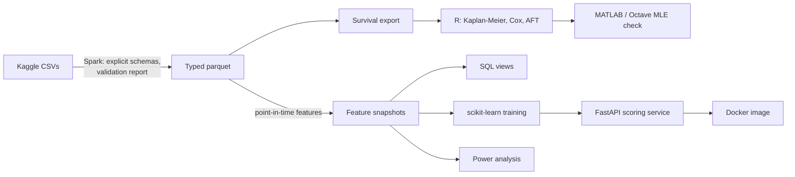

# Customer retention on real e-commerce data

[](https://github.com/ariyan-tipu/olist-customer-retention/actions/workflows/ci.yml)
[](LICENSE)

Churn modelling, survival analysis and experiment design on the Olist
Brazilian e-commerce dataset: 99,441 real orders across nine relational
tables, with all the mess that implies. The pipeline is PySpark, the
models are scikit-learn, the statistics engine is R's `survival`
package, MATLAB re-derives the key fit from the raw likelihood as a
validation step, and the trained model ships behind a FastAPI service in
Docker. Everything runs on a laptop for nothing, and the identical code
is Databricks-ready.

The data does not cooperate, and the write-ups say so: a repeat-purchase
base rate near one percent, 98% censoring, and an experiment that turns
out to be expensive to run properly. Those are the real numbers, reported
as what the data supports rather than worked around.

## Results at a glance

Every number below is produced by code in this repository; rerun the
quickstart and they regenerate.

**Repeat purchase prediction** (label: any further purchase within 180
days of the cutoff; trained at 2018-01-01, evaluated out of time at
2018-04-01):

| Model               | CV avg precision | Holdout ROC-AUC | Holdout PR-AUC | Lift at top decile |
| ------------------- | ---------------- | --------------- | -------------- | ------------------ |
| Logistic regression | 0.0318 ± 0.0117  | 0.611           | 0.0265         | 2.00x              |
| Gradient boosting   | 0.0278 ± 0.0121  | 0.652           | 0.0244         | 2.45x              |

The holdout base rate is 0.975% (64,089 customers), so a PR-AUC of
0.026 is nearly triple the no-skill line, and targeting the top decile
captures 20 to 24% of all repeaters at twice the background rate. The
selection rule (cross-validated average precision) picks the logistic
regression even though gradient boosting wins ROC-AUC on the holdout; the
disagreement between the two metrics at this imbalance is discussed in the
design notes below. On customers the training snapshot had never seen, lift
drops to 1.61x and that is reported too.


Those two plots rank the models in opposite orders, on the same holdout,
from the same predictions. Gradient boosting leads on ROC (0.652 against
0.611) and trails on average precision (0.024 against 0.027). ROC-AUC
integrates over the false-positive rate, and with 99% of customers
negative, a model can improve that a great deal while doing nothing useful
at the top of the ranked list, which is the only part anyone acts on.
Average precision asks the question the marketing team actually has. This
is why the metric had to be chosen before it could be shopped for.

A word on the selection rule, because "we chose the metric first" is the
kind of claim that is easy to make afterwards. The rule lives in
[`models/train.py`](src/olist_retention/models/train.py): cross-validation
runs on the training snapshot only, the winner is chosen on its mean
average precision, and the out-of-time snapshot is loaded afterwards purely
to score the model already picked. That structure is what enforces the
order, and it is worth being straight that it is the only evidence here.
There is no timestamped record proving the metric was fixed before the
holdout was ever examined, so read it as a design that makes the mistake
hard to make, not as an audited pre-registration.

**Survival analysis** ([full write-up](docs/survival-analysis.md)):
93,350 spells from first delivery to next purchase, 98.1% right-censored.
A one-or-two-star first review cuts the repurchase hazard by 27%
(HR 0.727, p = 0.0002). Late delivery is directionally negative
(HR 0.830) but not significant once the review is controlled, because a
late parcel does its damage mostly through the review. A year after
delivery, 2.49% of on-time customers have repurchased against 1.61% of
late-delivered ones.

**MATLAB validation**: the Weibull AFT fit is re-derived by maximising
the censored log-likelihood written out from first principles with
`fminsearch`. It agrees with R's `survreg` to at worst 2e-07 on every
parameter, with log-likelihoods matching at -18655.498. CI re-proves the
agreement in GNU Octave on every push.

**Experiment design** ([full write-up](docs/ab-test-design.md)):
detecting a plausible +15% relative uplift in the 0.975% repeat rate
takes 76,101 customers per arm at 80% power, more than a quarter's
entire intake. The write-up covers the Type I/II trade-offs, a Monte
Carlo check that the test's empirical error rates match the design, and
the realistic ways out (longer enrolment, a review-score proxy metric,
and why CUPED has no purchase on first-time customers).

## Architecture



The storage layout is a small medallion lake: raw CSVs with a
provenance manifest, validated typed parquet, then gold feature
snapshots partitioned by cutoff date. Paths are configuration, so the
same jobs run against local directories, Databricks volumes or S3
prefixes; [docs/databricks.md](docs/databricks.md) is the step-by-step
cloud story, including the free-tier route.

```
conf/pipeline.yaml        every knob in one typed, validated file
src/olist_retention/
  data/                   download with checksums, schemas, validation,
                          synthetic generator with planted effects
  pipeline/               Spark session, staging, features, survival export
  models/                 loading, training and evaluation
  experiments/            two-proportion power analysis and simulation
  service/                FastAPI app, pydantic contracts, model scorer
analysis/r/               survival analysis (survival package, base R)
analysis/matlab/          censored Weibull MLE cross-check (MATLAB/Octave)
sql/                      Databricks SQL views, executed for real in tests
notebooks/                EDA on the raw tables, committed with outputs
tests/                    48 tests incl. a handcrafted mini dataset that
                          pins leakage and censoring behaviour exactly
```

## Quickstart

Prerequisites: Python 3.11+, a JDK (17 recommended) for Spark, R for the
survival analysis, and MATLAB or GNU Octave for the cross-check. On
Windows, run `scripts/setup_windows_spark.ps1` once (checksummed
winutils shim for Spark's local writes) and set `HADOOP_HOME` as it
prints; Linux and macOS need nothing extra.

```bash
python -m venv .venv && . .venv/bin/activate   # Windows: .venv\Scripts\activate
pip install -e ".[spark,data,service,dev]"

olist-retention download      # ~43 MB from Kaggle, anonymous, with manifest
olist-retention pipeline      # validate, stage, build both snapshots + survival export
olist-retention train         # compare models, persist winner + metrics + plots
olist-retention power         # experiment sizing from the measured baseline

Rscript analysis/r/survival_analysis.R outputs/survival/survival_dataset.csv outputs/survival
octave --no-gui --eval "run('analysis/matlab/weibull_mle_check.m')"   # or matlab -batch

olist-retention serve         # scoring API on http://127.0.0.1:8000
pytest                        # full suite; Spark tests skip cleanly without a JDK
```

No account, card or cloud resource is required for any of it. The
pipeline is sized for a small laptop on purpose: two local Spark cores,
a 2 GB driver, and roughly six minutes end to end on the full dataset.

Scoring service, after training:

```bash
curl -X POST http://127.0.0.1:8000/v1/score -H "Content-Type: application/json" \
  -d '{"customers": [{"recency_days": 30, "frequency": 2, "avg_review_score": 5}]}'
```

The Docker image deliberately excludes Spark and mounts the model at
runtime (`docker build -t olist-scoring .` then
`docker run -p 8000:8000 -v "$PWD/models:/models:ro" olist-scoring`);
CI builds, boots and scores against it on every push.

## Design notes

**The identity trap.** Olist issues a fresh `customer_id` per order;
the person is `customer_unique_id`. Joining on the wrong one silently
turns customer analysis into order analysis. The grain is asserted in
schema docs, enforced in validation and pinned by tests.

**Point-in-time discipline.** Features at a cutoff may only use what
was knowable then: purchases count once placed, but delivery features
require the parcel to have arrived by the cutoff and review features
require the review to have been written. A handcrafted seven-customer
dataset pins each rule, including a customer whose order was in transit
across the cutoff. The same tests caught a real bug: naive datetime
literals crossed a British daylight-saving change and shifted every
boundary by an hour, which a UTC-only CI machine would never have seen.
Timestamp literals are now rendered as strings and parsed in the
session's pinned UTC timezone.

**Spark decisions, made for reasons.** The products and category
dimensions are explicitly broadcast, turning the basket join into a
map-side hash join with no shuffle of the item rows. Shuffle
partitions are set to 16, not the 200 default, because at 100k orders
the default creates hundreds of near-empty tasks whose scheduling
overhead dominates. The reused purchase spine is cached once,
deliberately, and everything else stays lazy so Spark can collapse the
plan. Snapshots are written as single parquet files because partitioning
below a few million rows is bookkeeping, not performance.

**Evaluation under a 1% base rate.** With a 0.975% base rate, ROC-AUC
flatters: the gradient booster "wins" ROC while losing average
precision, which is the metric aligned with actually targeting anyone.
Selection runs on cross-validated average precision over the training
snapshot, and the holdout is only loaded afterwards to score the winner.
Class weighting makes the scores rank well but destroys calibration, so
the service's outputs are treated as rankings; recalibration on a held-out
slice is the stated next step before anyone reads them as probabilities.


The gap between that curve and the diagonal is the whole point. Class
weighting pushed predicted probabilities into the 0.25 to 0.65 range while
the observed repeat rate never leaves about 2%, so the numbers order
customers correctly and mean nothing as probabilities. A model that is
useful and badly calibrated at the same time is normal; quoting its output
as "a 60% chance of repurchase" would not be.

The out-of-time evaluation also surfaces genuine drift: the base rate moves
from 1.286% to 0.975% between cutoffs, which is production reality rather
than an inconvenience.


Permutation importance is measured on the holdout rather than in-sample, so
it reports what actually carried signal out of time.

**Censoring is not churn.** 98.1% of survival spells are censored. The
write-up spells out why deleting or mislabelling those customers wrecks
every estimate, and the CI stats job proves the machinery end to end:
the synthetic generator plants known effects (late delivery and bad
reviews stretch the time to the next purchase), R must recover both
directions significantly, and Octave must reproduce R's fit from the
raw likelihood, on every push.

**SQL that is proven, not decorative.** The Databricks SQL views in
`sql/` execute against Spark temporary views inside the test suite, so
a broken view fails the build rather than a dashboard.

## Continuous integration

Six jobs on every push, all free tier: ruff lint; the pytest suite on
Python 3.11 and 3.13 (Spark included via a Temurin JDK); the synthetic
statistics job (Spark pipeline, R survival, planted-effect gate, Octave
MLE cross-check, artefacts uploaded); a headless execution of the EDA
notebook; and a Docker job that trains a model, builds the image, boots
it with the model mounted and scores a request through the real HTTP
surface.

## Data, licences and conventions

* **Code**: MIT, see [LICENSE](LICENSE).
* **Data**: the [Olist Brazilian e-commerce dataset](https://www.kaggle.com/datasets/olistbr/brazilian-ecommerce),
  published by Olist on Kaggle under CC BY-NC-SA 4.0. The data is not
  redistributed here; the downloader fetches it from the source and
  records sizes and SHA-256 digests in a manifest. The licence is
  non-commercial, which a portfolio analysis respects.
* British English throughout the prose; identifiers from library APIs
  (`color=`, `normalize=`, `upload-artifact`) keep their canonical
  spellings.

## Limitations and where this would go next

The dataset ends in 2018, so the models are a study in method rather
than a live product; recalibration, a recurrent-events survival model
for multi-repeat customers, a time-varying coefficient for the
instalments term flagged by the proportional hazards diagnostics, and
probability calibration ahead of the scoring service are the natural
next steps. The Databricks document describes how the identical
pipeline moves to a cluster and S3 when the data outgrows a laptop,
which is the point of writing it this way.
