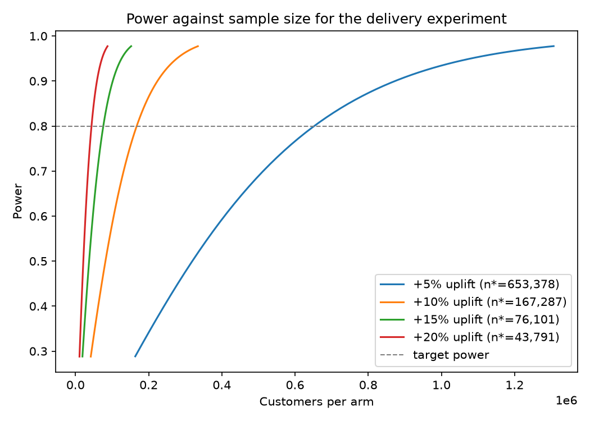

# A/B test design: does faster delivery bring customers back?

## Why an experiment at all

The survival analysis leaves a deliberate loose end. Late deliveries go
with far fewer repeat purchases (2.49% versus 1.61% a year out), but in
the adjusted Cox model the late-delivery hazard ratio (0.830) is not
significant once the review score is controlled, because a late parcel
mostly hurts by wrecking the review. Observational data cannot say what
paying for faster carriers would actually buy, and only randomisation
separates "late deliveries cause churn" from "the kinds of orders that
run late belong to customers who were not coming back anyway".

The hypothetical intervention: upgrade a random half of new customers'
first orders to a faster carrier service.

## Design

* **Unit of randomisation:** customer, assigned at first checkout.
  Assignment at the customer level avoids the same person landing in
  both arms on later orders.
* **Primary metric:** repeat purchase within 180 days of the first
  delivery, a binary outcome per customer, matching the label the rest
  of the project models.
* **Baseline:** measured, not guessed. The 2018-04-01 feature snapshot
  puts the 180 day repeat rate at **0.9752%**.
* **Test:** two-proportion z-test with pooled variance, two-sided at
  alpha = 0.05, target power 0.80.

## The error budget, in plain terms

* A **Type I error** here means telling operations that faster carriers
  grow repeat business when they do not, and paying premium freight on
  every order for nothing. Alpha caps how often that happens at 5%.
* A **Type II error** means the uplift is real and the test misses it,
  the programme is cancelled, and the margin left on the table is
  invisible forever. Power is the insurance against that, bought with
  sample size.

Two-sided testing is kept despite the directional hypothesis: a faster
service that somehow reduced repeat purchase (for example by cannibalising
a same-day pickup habit) is exactly the surprise a one-sided test would
be blind to.

## What it costs: the power analysis

Computed from first principles (normal approximation with pooled
variance) in `olist_retention/experiments/power.py`, then verified by
Monte Carlo simulation with 20,000 replications per scenario. The
simulated power confirms the formula, and rerunning the same simulated
test with the effect switched off confirms the false positive rate sits
at the nominal alpha.

| Relative uplift | Repeat rate      | n per arm | Simulated power | Simulated alpha |
| --------------- | ---------------- | --------- | --------------- | --------------- |
| +5%             | 0.975% to 1.024% | 653,378   | 0.801           | 0.051           |
| +10%            | 0.975% to 1.073% | 167,287   | 0.797           | 0.049           |
| +15%            | 0.975% to 1.121% | 76,101    | 0.803           | 0.050           |
| +20%            | 0.975% to 1.170% | 43,791    | 0.806           | 0.048           |

## The conclusion: this experiment is expensive

Olist acquires roughly 60,000 to 65,000 new customers a quarter in this
period. Even the optimistic +15% scenario needs 76,101 customers **per
arm**, more than a full quarter's intake split across both arms, before
the 180 day follow-up even starts. A rare binary outcome makes
experiments brutally expensive, and pretending otherwise is how teams
end up shipping underpowered tests and overreading noise. Realistic ways
through, in order of preference:

1. **Enrol for longer.** Two quarters of intake covers the +15%
   scenario; with the 180 day follow-up the answer arrives in about nine
   months. Slow, but it measures the metric that matters.
2. **Move to a more sensitive proxy metric.** The first review score is
   continuous-ish, arrives within days rather than 180, and the
   survival analysis shows it carries most of the late-delivery damage.
   A two-arm test on mean review score is powered orders of magnitude
   better; the repeat-rate effect is then argued through the measured
   review-to-retention link rather than measured directly. That
   indirection is the price of speed and must be stated in any read-out.
3. **Accept a larger minimum detectable effect.** Sizing for +20% costs
   43,791 per arm; the risk is a genuinely useful +10% effect reading as
   "no significant result".
4. **Variance reduction (CUPED and friends) helps little here.** The
   units are first-time customers with no pre-experiment history, so
   there is no strong pre-period covariate to regress out. This lever,
   usually the first one pulled at large companies, is mostly
   unavailable for new-customer experiments, which is worth knowing in
   itself.

Two operational cautions complete the design. Interim peeking at a fixed
alpha inflates the false positive rate well past 5%, so either the
analysis waits for the planned sample or a proper sequential procedure
is pre-registered. And if several uplift scenarios or metrics are read
out together, the multiple-comparison cost has to be paid explicitly
rather than discovered in the replication attempt.
