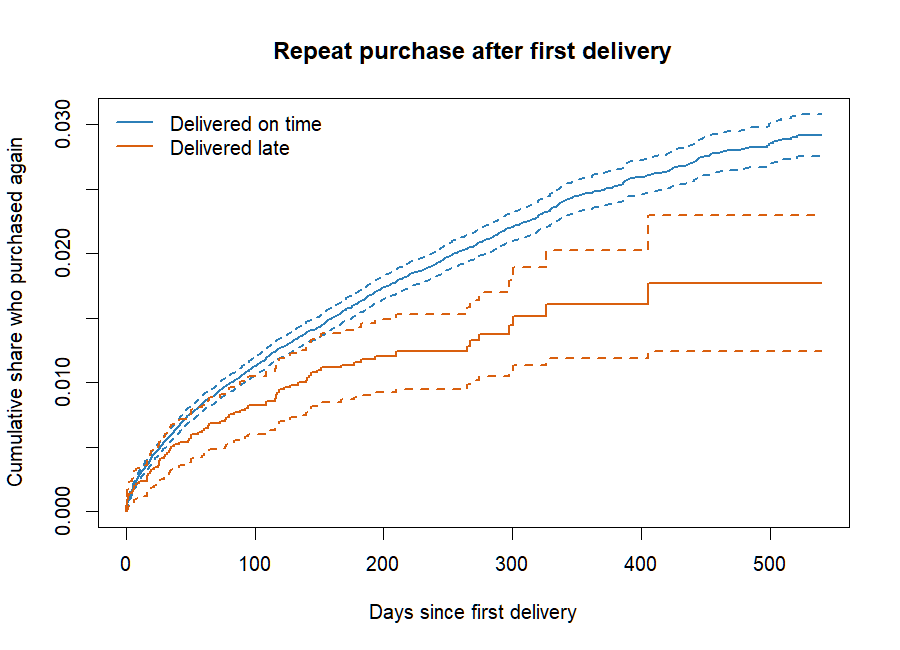
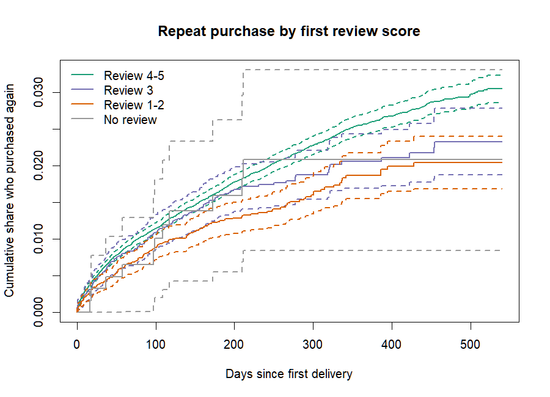

# Survival analysis: time to the next purchase

## The question

After a customer's first order arrives, how long until they buy again,
and how does that first experience change the odds of them ever coming
back? A classifier with a fixed 180 day window answers a blunter version
of this and throws away everything it cannot fit in the window. The
survival framing keeps all of it.

## The data and why censoring is the whole game

Each customer whose first order was delivered contributes one spell:

* origin: the delivery timestamp of the first order,
* event: the next non-cancelled purchase after the origin,
* censoring: no further purchase by the end of the data
  (2018-10-17).

The export contains **93,350 spells with 1,808 events, so 98.1% of
customers are censored**. They are not churned; the only fact known about
them is that their time to the next purchase exceeds what was observed.
Dropping them would shrink the study to under two percent of customers,
and labelling them as never returning would be an outright fabrication:
some of them did return after the window closed. The survival machinery
uses exactly the information censored customers carry and nothing more,
which is why it is the right tool and why this analysis exists.

One wrinkle is counted rather than hidden: **830 customers placed their
second order before the first one had arrived**. Their enthusiasm cannot
be credited to a delivery experience they had not yet had, so the spell
measures the next purchase after delivery and the metadata records how
many such customers there are.

## Kaplan-Meier: what actually happens

Cumulative share who purchased again, by whether the first delivery beat
its promised date:

| Days since delivery | Delivered on time | Delivered late |
| ------------------- | ----------------- | -------------- |
| 90                  | 1.05%             | 0.79%          |
| 180                 | 1.61%             | 1.16%          |
| 365                 | 2.49%             | 1.61%          |

A year out, late-delivered customers have returned at roughly two thirds
the rate of on-time customers. The review-score view is steeper still:

## Cox proportional hazards: what drives the difference

The Cox model estimates the hazard of repurchasing, so a hazard ratio
below one means slower or less likely return. Fitted on all spells with
covariates from the first order:

| Covariate                  | Hazard ratio | 95% CI         | p        |
| -------------------------- | ------------ | -------------- | -------- |
| Late delivery              | 0.830        | 0.652 to 1.056 | 0.129    |
| Review 3 (vs 4-5)          | 0.843        | 0.706 to 1.007 | 0.059    |
| Review 1-2 (vs 4-5)        | 0.727        | 0.613 to 0.862 | 0.0002   |
| No review (vs 4-5)         | 0.828        | 0.456 to 1.503 | 0.535    |
| log order value            | 0.862        | 0.806 to 0.922 | < 0.0001 |
| Items in first order       | 1.184        | 1.118 to 1.255 | < 0.0001 |
| Instalments                | 1.050        | 1.031 to 1.068 | < 0.0001 |
| Region nordeste (vs sudeste) | 0.657      | 0.543 to 0.795 | < 0.0001 |

Reading the table:

* **A bad first review is the strongest experience signal.** Customers
  who left one or two stars carry a 27% lower repurchase hazard, and the
  effect is clearly significant.
* **Late delivery is directionally negative but not significant once the
  review is controlled.** That is not a contradiction of the KM gap
  above; it says most of the late-delivery damage travels through the
  review. The EDA shows a late parcel costs about two stars, and the
  review then carries the effect. Observational data cannot cleanly
  split the direct effect from the mediated one, which is precisely the
  argument for the experiment in the A/B design document.
* **Bigger baskets return more slowly, more items return faster.** A
  large one-off considered purchase behaves differently from a habit
  forming multi-item shop.
* **Geography matters.** Customers in the north east repurchase at
  roughly two thirds the hazard of the south east, consistent with
  longer transit times and thinner logistics coverage.

## Diagnostics, stated plainly

`cox.zph` flags instalments (p = 0.021) and is marginal globally
(p = 0.040), so the proportional hazards assumption does not hold
perfectly; the instalments effect drifts over time. The quoted hazard
ratios are therefore time-averaged effects. The standard remedies, left as
extensions, are a time-varying coefficient for instalments or
stratification; the substantive conclusions above do not hinge on that
term.

Because the shape parameter of the Weibull fit below is under one
(1/exp(0.487) = 0.614), the baseline hazard is decreasing: a customer is
most likely to return in the weeks right after a delivery, and the
propensity decays from there. Win-back activity has a natural clock.

## The MATLAB validation: proving the likelihood, not trusting it

R's `survreg` fits an accelerated failure time model,
log(T) = b0 + b1 late + b2 low_review + sigma W, with W following the
smallest extreme value distribution. The MATLAB script
(`analysis/matlab/weibull_mle_check.m`) writes the censored log-likelihood
out from first principles

* event: `log f(t) = z - exp(z) - log(sigma) - log(t)`
* censored: `log S(t) = -exp(z)`, with `z = (log t - Xb) / sigma`

and maximises it numerically with `fminsearch`, with no statistics
toolbox involved. On the real export:

| Parameter          | R survreg  | Direct MLE | Abs. difference |
| ------------------ | ---------- | ---------- | --------------- |
| Intercept          | 11.891109  | 11.891109  | 5e-08           |
| Late delivery      | 0.383103   | 0.383102   | 2e-07           |
| Low review         | 0.424935   | 0.424935   | 7e-08           |
| log scale          | 0.487223   | 0.487223   | 5e-09           |
| Log-likelihood     | -18655.498 | -18655.498 | 9e-11           |

Mapped through the shape parameter, those coefficients imply hazard
ratios of 0.790 for late delivery and 0.770 for a low review, consistent
with the Cox estimates from the richer model. The same script runs in
GNU Octave in CI on synthetic data with planted effects, so the
agreement is re-proven on every push, not just once on a laptop.

## Limitations

* One spell per customer (first to second purchase); later spells exist
  for a few thousand customers and could support a recurrent-events
  model.
* The review score is the first order's final review, which usually
  arrives days after delivery. This analysis is explanatory, not a
  scoring model, so that timing is acceptable here and is deliberately
  not mirrored in the classifier's features.
* Order status is a snapshot, so a small number of late status changes
  are invisible.
